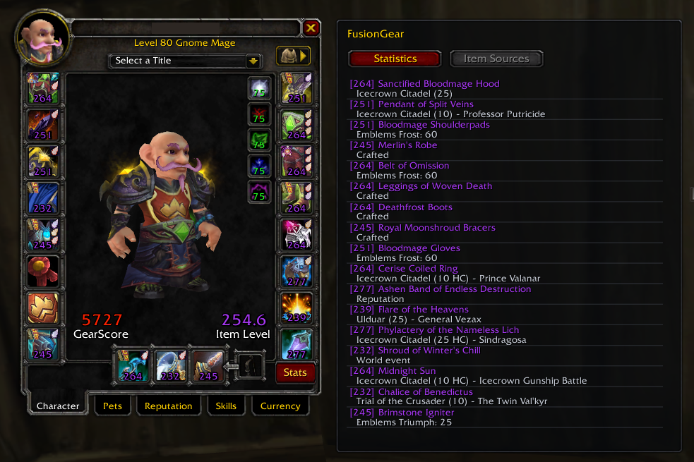
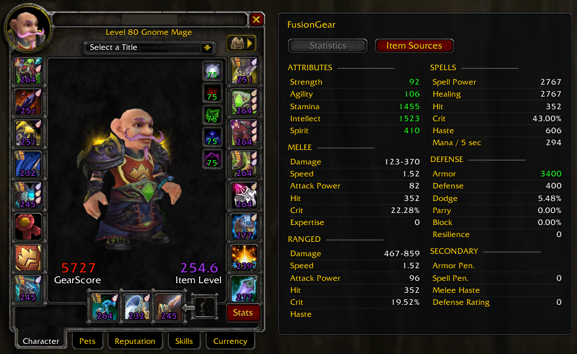

# FusionGear

Small equipment addon for World of Warcraft 3.3.5a

I made this to have item levels, gems, enchants and item sources in one place without replacing the original character window
Basically purpose to a create Cata/MoP-style stat overview for quick inspection-like when pugging or assembling a raid roster quilky

So, if there are any potential UI issues or addon incompatibilities due quikly developnent and not mutch time to test this
please drop me a link to the mod and describe the cause in the issues report

## Screenshots

## Features

- per item level numbers on equipped items
- small gem and enchant icons next to equipment slots
- extra stats and item source panels
- item sources for character and inspect windows
- GearScore and average item level from GearScoreLite (full too)

## Addons used for reference to make this

- AllStats - extra character stats panel
https://warperia.com/addon-wotlk/all-stats

- InspectEquip - item source database and source display
https://warperia.com/addon-wotlk/inspectequip

- ShowMeiLvl - enchant ID data and item level display
https://warperia.com/addon-wotlk/showmeilvl

- zzzMoPItemTooltips - ideas for shorter item tooltip text
https://ezwow.org/topic/134110-mop-item-tooltips-11

- Equipence - gem and enchant icon layout ideas
https://github.com/s0h2x/Equipence

- GearScoreLite Reborn - original GearScore functions and colors
https://github.com/Arcitec/GearScoreLite_Reborn

also used the original Blizzard 3.3.5a FrameXML as reference for the character window, Inspect and tooltips
https://github.com/wowgaming/3.3.5-interface-files

GearScoreLite is a separate addon and its code is not included here

## Compatibility

- World of Warcraft 3.3.5a (12340)
- Interface 30300
- Made for WotLK servers such as Warmane

GearScoreLite Reborn (or old Gear full or lite whatever) is needed for GearScore and average item level numbers
Other parts can run without it

## Languages

English only for now
There are no separate localization files
This is stay for future TODO list

## Installation

1. Copy the FusionGear folder to Interface/AddOns
2. Enable FusionGear in the addon list
3. Keep GearScoreLite enabled if you want GearScore numbers
4. Restart the game

## Commands

- /fg - toggle the extra panel
- /fg stats - show stats
- /fg sources - show item sources
- /fg icons 80 - set icon opacity from 20 to 100
- /fg tooltip on - enable compact tooltip text
- /fg tooltip off - use original tooltip text
- /fg help - show available commands
